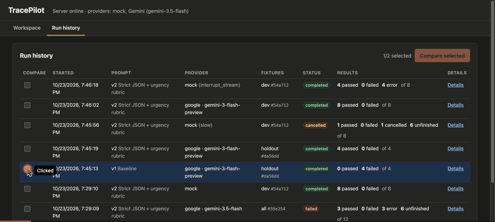
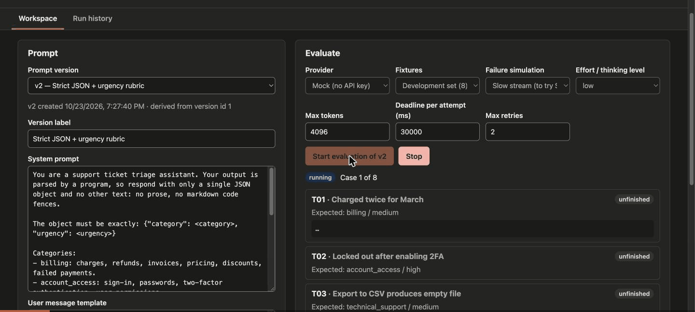

# TracePilot

**Did this prompt change improve my application, and can I trust how it behaves when something fails?**

TracePilot is a local console for evaluating Claude prompts. You save prompt versions, run them against reusable test cases, watch responses stream in, and compare correctness, latency and token usage side by side. Every run records the exact prompt text, model settings and test-case snapshot it used, so a result can always be traced back to its inputs.

The built-in use case is support-ticket triage: the model classifies 12 synthetic tickets into a category (`billing`, `account_access`, `technical_support`, `general_inquiry`) and an urgency (`low`, `medium`, `high`), and TracePilot checks that each response is a bare JSON object with the required fields, allowed values and expected labels.

Claude is the target provider. Until an Anthropic key is configured, the live results below were measured with a **Google Gemini** key through the same provider interface, alongside a deterministic **mock** provider that needs no key at all.

**Stack:** React 19, TypeScript, Vite · Node.js, Express 5, SQLite (better-sqlite3) · Anthropic TypeScript SDK, Google GenAI SDK · Vitest, MSW, Testing Library

| Compare two prompt versions and inspect a run | Stop a run and see interrupted streams |
| --- | --- |
|  |  |

---

## Quick start (mock mode, no API key)

Requires Node.js **22.12 or newer** (`.nvmrc` pins 24).

```sh
git clone <this repo> && cd tracepilot
nvm use            # optional
npm install
npm run dev        # API on :8787, interface on http://localhost:5173
```

Open http://localhost:5173, choose a prompt version, and press **Start evaluation**. Everything works with the mock provider. To try failure handling without an API key, pick a **Failure simulation** scenario before starting a run.

| Command | Purpose |
| --- | --- |
| `npm run dev` | API server (tsx watch) and Vite interface together |
| `npm run eval -- [--provider mock\|anthropic\|google] [--model id] [--split dev\|holdout\|all] [--versions 1,2] [--repeat n] [--json file]` | Run prompt versions from the command line and print a per-case report; the runs also appear in the interface |
| `npm test` | All tests (Node project for server and SDKs, jsdom project for components) |
| `npm run typecheck` / `npm run lint` | Type checking (server and client) / ESLint |
| `npm run check` | Typecheck, lint and test, as CI does |
| `npm run build` | Production build of the interface |

Local data lives in `data/tracepilot.db`, which is ignored by Git. Delete it to reset the workspace; the two seed prompt versions are recreated on the next start.

## Providers: mock, Claude, and Gemini

| | Mock | Claude API | Gemini API (development stand-in) |
| --- | --- | --- | --- |
| Needs | nothing | `ANTHROPIC_API_KEY` | `GEMINI_API_KEY` (or `GOOGLE_API_KEY`) |
| Default model | – | `claude-opus-5-5` (`TRACEPILOT_MODEL`) | `gemini-3.5-flash` (`TRACEPILOT_GOOGLE_MODEL`) |
| Responses | deterministic keyword rules, streamed in small chunks | real model output | real model output |
| Usage | always **unknown**: there is no API to report it | `input_tokens` / `output_tokens` | `promptTokenCount` / `candidatesTokenCount + thoughtsTokenCount` |
| Request ID | synthetic `mock_req_…` | `request-id` header | **unavailable**: the API sends none, so it is shown as such; `responseId` is kept as the message ID |
| Effort setting | ignored | `output_config.effort` | `thinkingConfig.thinkingLevel` (low→LOW, medium→MEDIUM, high and above→HIGH) |
| Failure injection | `slow`, `rate_limit_once`, `interrupt_stream`, `malformed`, `timeout` | whatever the network and API do | whatever the network and API do |

Keys go in `.env` (see `.env.example`). They are read only by the server, never sent to the browser, and never stored in run records; tests check this. A provider shows up in the interface only when its key is set.

- **Mock.** Exists so the workflow, the interface and the failure handling can be demonstrated and tested offline. It reacts to prompts in a deliberately simple way: a prompt that says "respond with only…" gets bare JSON, and one that contains "urgency guidelines" gets better urgency labels. **Mock scores say nothing about how a real model would score.**
- **Claude.** Runs use `effort: low`, because classification is a short task, and enable the API's server-side refusal fallback (`fallbacks: "default"`), which you can switch off per run. When a fallback serves a response, the run details show which model actually answered.
- **Gemini.** Maps onto the same failure kinds as Claude, so retries, interruption labels and telemetry behave identically. The free tier is tight: **5 requests per minute and 20 requests per day, per model**. TracePilot honours Google's `RetryInfo` delay for per-minute limits and fails fast on the daily one (see below). A requested alias can be served by a newer model (`gemini-3.5-flash` was served by `gemini-3.6-flash`); the run details flag this.

## Architecture

```
client/            React interface and component tests
  src/hooks/       useRunStream (EventSource → reducer), hash routing
  src/components/  PromptEditor, RunPanel, RunHistory, CompareView, RunDetails, CaseCard
server/
  routes/          Express routes; zod-validated bodies; SSE stream and cancel
  provider/        Provider interface; ClaudeProvider (Anthropic SDK), GeminiProvider
                   (Google GenAI SDK), MockProvider
  providers.ts     which providers exist on this server, based on configured keys
  runner/          RunManager (one active run, event fan-out, cancellation) and
                   executeCase (attempts, deadlines, retries, telemetry)
  evaluate/        parseJson, validate, compare, evaluate — small pure functions
  db/              migrations, database opener, Repository
  cli/             npm run eval
shared/            types, SSE event protocol, summary rules, default settings
fixtures/          12 synthetic tickets (8 dev, 4 holdout) and the two seed prompts
tests/             integration, SSE, MSW failure-simulation tests for both SDKs
docs/eval/         raw JSON of the live evaluation runs reported below
docs/media/        demo recordings
```

**Request flow.** `POST /api/runs` validates the request, copies the prompt version, model settings and selected fixtures into a new `queued` run, and returns it. The client then opens `GET /api/runs/:id/stream` (server-sent events). Opening the stream starts the run, so execution is tied to an observer. The runner executes cases **one at a time** and emits `run_status`, `case_status`, `case_delta`, `case_retry`, `case_result` and `run_end` events. `POST /api/runs/:id/cancel` (the **Stop** button), or the last client disconnecting, aborts the run's `AbortController`. That signal is passed to the SDK, so the in-flight HTTP request is aborted, not just ignored.

**State.** Runs move `queued → running → completed | failed | cancelled`. Cases move `queued → running → completed | failed | cancelled`. A case that never started stays `queued` and is shown as **unfinished**. The interface groups cases into five buckets — passed, failed checks, error, cancelled, unfinished — so an incomplete evaluation never looks like a clean result.

**Several processes, one database.** The API server and the CLI can share the same SQLite file. Each running run records the PID of the process executing it. On startup, the server marks a run failed only if that process no longer exists, so restarting the server never mislabels a CLI run that is still going. Queued runs stay queued, because they can still be started.

**Persistence and immutability.** SQLite with ordered, append-only migrations. Database triggers reject any `UPDATE` or `DELETE` on `prompt_versions` and any change to a run's recorded inputs, so "editing a prompt cannot change an earlier run" is enforced by the schema, not just by convention. Saving an edit always creates a new version (`parent_id` links it to its source). Each run stores a hash of its fixture snapshot, and the comparison view warns when two runs were not evaluated on identical cases.

**Evaluation.** Five checks run in order: `json_parse` → `required_fields` → `allowed_values` → `category_match` → `urgency_match`. A case passes only if all five pass, and every failed or skipped check carries a sentence explaining why. When the JSON check fails but an object can be recovered (from a code fence or surrounding prose), the remaining checks still run against the recovered object and say so. That separates "wrong format" from "wrong answer", which turned out to be the main finding of the live evaluation.

## Failure handling and telemetry

| Situation | Behaviour |
| --- | --- |
| 429, 5xx, overloaded (529/503), connection error, deadline hit **before any text** | Retried up to `maxRetries` (default 2) with backoff of 250 ms × 2ⁿ (capped at 4 s), or the server's requested delay (`retry-after`, Gemini `RetryInfo`) up to 120 s. Each attempt is logged with its error, request ID and delay, and saved before the wait starts, so a long backoff is visible from any tab or the CLI. |
| Server asks for a wait **longer than 120 s** (e.g. a daily quota) | Not retried: retrying sooner than asked is guaranteed to fail. The case fails at once with a message giving the requested wait. |
| Any failure **after text has started** | Not retried. The partial output is kept and the case is labelled **interrupted**, so a retry can never silently replace output you already saw. |
| Deadline (`timeoutMs`, default 30 s) | Per attempt and covers the whole attempt, including streaming. Implemented with its own `AbortController`, so it uses the same abort path as Stop. |
| 401/403, 400/404/422 | Not retryable. The run stops with a `failed` status and a reason, because every remaining case would fail the same way. |
| Malformed output | The case completes; the `json_parse` check fails with the parser's reason. |
| Unusual stop reason (anything except Claude's `end_turn` or Gemini's `STOP`, e.g. `max_tokens`, `refusal`, `SAFETY`) | Recorded per case and quoted in the JSON check's explanation. |

Per case, TracePilot records time to first text (measured from the start of the successful attempt), total duration including retries, API-reported input and output tokens, request ID, message ID, served model, stop reason and the attempt log. **Missing values stay `null` and are shown as "unknown"**: run totals become a lower bound ("≥ 1,240 (1 unknown)") instead of a sum that quietly treats unknown as zero. The run-details view puts these measurements next to the exact prompt text and model settings that produced them.

Both SDKs have their own retries disabled (Anthropic `maxRetries: 0`, Google `retryOptions.attempts: 1`), so the runner owns the retry policy and every attempt is visible.

## Evaluation results

### Method

- **Prompts.** v1 *Baseline*: a four-line instruction that asks for JSON. v2 *Strict JSON + urgency rubric*: demands a bare JSON object with no code fences, defines each category, gives urgency guidelines, and says to classify by root cause.
- **Cases.** The 8 dev tickets (T01–T08) were used while writing prompts; the 4 holdout tickets (T09–T12) were reserved for the final evaluation and not used to tune wording.
- **Settings.** Effort `low` (Gemini thinking level LOW), max tokens 4,096, deadline 30 s per attempt, up to 2 retries before output. Each case was run **once**: the free tier's 20 requests per model per day did not allow repetitions, so these results show no run-to-run variance.
- **Command.** `npm run eval -- --provider google --model <model> --split <split> --versions 1,2 --json docs/eval/<file>.json`. The raw records, including every check explanation and attempt, are in [`docs/eval/`](docs/eval).

### Headline

| Model (as requested → as served) | Set | v1 Baseline | v2 Strict JSON + rubric |
| --- | --- | --- | --- |
| `gemini-3-flash-preview` | **Holdout (final), 4 cases** | **0 / 4 passed** | **4 / 4 passed** |
| `gemini-3-flash-preview` | Dev, 8 cases | not run (quota) | 8 / 8 passed |
| `gemini-3.5-flash` → `gemini-3.6-flash` | All 12 | 0 / 12 passed | 3 / 3 passed before the daily quota ran out (3 errors, 6 not run) |

**v2 is the better prompt for this application, but the reason is format, not judgement.** Every v1 response was rejected by the JSON check, because Gemini wrapped the object in a markdown code fence (` ```json … ``` `), and the application contract is a bare object. Against the objects recovered from those fences, v1's labels were right in **15 of 16** case-model pairs: all four holdout cases on both models, and every dev case except T01, where `gemini-3.5-flash` said urgency `high` for a duplicate-charge refund that the fixture rates `medium`. So the urgency rubric fixed at most that one label. The instruction that mattered was "respond with only a single JSON object… no markdown code fences". A reviewer who only saw pass rates would credit the rubric; the per-check explanations show otherwise.

### Final holdout evaluation (`gemini-3-flash-preview`)

| Ticket | Expected | v1 prediction | v1 result | v2 prediction | v2 result | v2 first text | v2 duration | v2 tokens in / out | v2 attempts |
| --- | --- | --- | --- | --- | --- | --- | --- | --- | --- |
| T09 Former employee still has admin access | account_access / high | account_access / high | fail: fenced JSON | account_access / high | pass | 1.85 s | 1.87 s | 274 / 264 | 1 |
| T10 Card declined, account suspended | billing / high | billing / high | fail: fenced JSON | billing / high | pass | 1.63 s | 1.69 s | 277 / 261 | 1 |
| T11 Dark mode toggle doesn't persist | technical_support / low | technical_support / low | fail: fenced JSON | technical_support / low | pass | 1.62 s | 37.76 s | 262 / 195 | 2 |
| T12 Partnership question | general_inquiry / low | general_inquiry / low | fail: fenced JSON | general_inquiry / low | pass | 0.78 s | 0.88 s | 257 / 16 | 1 |

T10 is the deliberately ambiguous case: a failed payment that locks the team out. Both prompts chose `billing`, matching the fixture's root-cause label. T11's 37.76 s is a real per-minute rate limit: the first attempt got HTTP 429 (`limit: 5` requests per minute on the free tier), the runner waited the 36 s Google asked for, and the second attempt succeeded. Its time to first text (1.62 s) is measured on that successful attempt.

### Dev set, v2 (`gemini-3-flash-preview`)

All 8 passed. First text ranged from 0.67 s to 3.39 s (median 1.53 s). T06 waited 50 s for a per-minute rate limit and then passed on its second attempt.

### Latency and tokens: what the telemetry shows

- **First text ≈ total duration.** Across the 27 successful single-attempt cases, the gap between first text and completion was 1–223 ms (median 61 ms). The answer arrives in one or two chunks after the model finishes thinking, so for this task first-text time mostly measures thinking time, not network or decoding speed.
- **Output tokens are mostly thinking.** The answer itself is about 15 tokens, yet reported output ranged from 15 to 622 tokens. Gemini counts thinking tokens as output, and TracePilot adds them so totals reflect what is billed. Latency followed thinking: the slowest single-attempt case (T07, 3.39 s) had the most output tokens (622), and the two fastest (T03 and T05, around 0.7 s) had 15.
- **The stricter prompt costs input.** v2's longer system prompt used about 2.8× the input tokens of v1 (272 vs 96 per case on average). That is the price of the definitions and rubric, and the data above suggests a much shorter "bare JSON only" instruction might get the same pass rate. That is the next experiment to run.
- **Rate limits dominate wall time on the free tier.** The v2 holdout run took 42 s of wall time, 36 s of it waiting on a 429.

### Failure handling observed against the live API

The free tier exercised the failure paths for real:

| What happened | How TracePilot handled it |
| --- | --- |
| Per-minute quota (HTTP 429, `RetryInfo` 9–57 s) | Waited exactly the requested delay and succeeded on the next attempt (v1 T07 and T08 on 3.5-flash, v2 T11 and T06 on 3-flash-preview). Each wait appears in the attempt log. |
| Daily quota exhausted mid-run (HTTP 429, quota `GenerateRequestsPerDayPerProjectPerModel-FreeTier = 20`, `retryDelay` ≈ 4.3 h) | The run was still using the old 30 s retry cap at the time, so T04–T06 each retried early, failed three times, and burned up to 4 minutes per case. **Fixed:** the cap was raised to 120 s, and a requested wait beyond it now fails the case at once with a clear message. |
| `gemini-3.8-flash` returned HTTP 503 "experiencing high demand" during model selection | Maps to the retryable `overloaded` kind; covered by tests. |
| One intermittent HTTP 403 `PERMISSION_DENIED` in a smoke run, from a key that had worked seconds earlier | Treated as a non-retryable auth error, which stopped the run. That is correct for a real permission problem, but here it was transient. Not changed: retrying 403s would hide genuine misconfiguration. |
| The dev server restarted (file watcher) while the CLI was mid-run, and marked the CLI's run as abandoned | **Fixed:** runs now record their owner's PID (migration 2), and startup cleanup skips runs whose process is still alive. The affected record's status reason was corrected by hand to say what happened. |

### Mock provider

`npm run eval -- --provider mock --split holdout`: v1 0/4 (code fence, plus wrong urgency on T11 and T12 and a wrong category on T10); v2 4/4. Dev: v1 0/8, v2 8/8. These figures only show that the pipeline and explanations work; the mock's rules were written alongside v2.

### Claude API (not yet run)

The Claude evaluation is still pending an Anthropic key. Once `ANTHROPIC_API_KEY` is in `.env`:

```sh
npm run eval -- --provider anthropic --split holdout --versions 1,2 --json docs/eval/claude-holdout.json
npm run eval -- --provider anthropic --split dev --versions 1,2 --repeat 3 --json docs/eval/claude-dev.json
```

The second command repeats each case three times to measure consistency, which the Gemini free tier could not afford. Report the Claude results here next to the Gemini ones, including any failures.

## Browser check (Chrome, 1440×900 and narrow)

The interface was checked in Chrome on the real dev server with live Gemini and mock runs. The two recordings at the top were made in this session.

| Checked | Result |
| --- | --- |
| Rendering, dark scheme | Correct; no console errors during load, runs, comparison or run details. |
| Keyboard | Tab order follows the visual order (navigation, prompt editor, run settings, Start/Stop). Start works with Enter, and a visible blue focus outline is drawn on every control. The full keyboard-only workflow is also covered by automated tests. |
| Text contrast (computed from the CSS tokens, WCAG 2.1) | Every text and background pair passes AA in both schemes: body text 13.0–16.9:1, muted text 6.3–7.2:1, all status badges 7.1–8.9:1, button text 5.0–6.2:1, focus ring 5.7–8.6:1. |
| Form-control borders | **Failed, fixed.** They were 1.43:1 against their background, below the 3:1 required for component boundaries (WCAG 1.4.11). A dedicated `--control-border` token now gives 3.5–4.1:1. |
| Narrow window (500 px, Chrome's minimum) | Single-column layout and no horizontal page scroll. Wide tables scroll inside their own container. |
| Streaming, Stop, interrupted streams, comparison, run details | Work as designed; see the recordings. |

Other issues found in the browser and fixed:
- the case currently streaming was badged "unfinished" instead of "running";
- run history didn't refresh for runs started from the CLI or another tab (it now refreshes when opened and polls while a run is in progress);
- paired cards in the comparison stretched to equal height, so the shorter card's content floated down;
- "Open run details" links were centred;
- the settings group showed the browser's default fieldset border;
- a long label pushed its input out of line with its neighbours;
- the JSON explanation said "with extra text" for a response that was only a code fence;
- Gemini error messages kept stray escape characters from the double-encoded error body.

Not yet checked: a screen-reader pass, and the light colour scheme in the browser (its contrast was verified by calculation).

## Testing

`npm test` runs 72 tests in two Vitest projects. None needs an API key, and CI (`.github/workflows/ci.yml`) runs type checking, lint, tests and the build with no credentials.

- **Evaluators** (`server/evaluate/*.test.ts`): each check on its own, with exact explanation strings.
- **Runner policy** (`server/runner/executeCase.test.ts`): fake timers drive retries, backoff, `retry-after`, the 120 s cap and fail-fast beyond it, deadlines before and during output, interrupted output, unknown usage, progress saved before backoff, and cancellation during backoff. Timings are asserted to the millisecond.
- **Claude failure simulation** (`tests/failureSimulation.test.ts`): the real `ClaudeProvider` and runner against an MSW-simulated Messages API that follows the documented SSE event order. Covers 429 with `retry-after`, persistent 529, a response that never starts, malformed text, missing usage, a dropped connection mid-stream, an `error` event mid-stream, an `error` event before text, 401, and cancellation mid-stream. The cancellation test asserts on the signal of the actual `fetch` call the SDK made.
- **Gemini adapter** (`tests/geminiProvider.test.ts`): the real `GeminiProvider` against MSW-simulated `streamGenerateContent` SSE. Covers streamed text excluding thought parts; usage, response ID, served model and finish reason; unknown usage; 429 with `RetryInfo`; status mapping for 503, 500, 403 and 404; abort; the double-encoded error body as observed live; an error chunk after text (interrupted, not retried); and a 503 before text (retried, then passes).
- **SSE and persistence** (`tests/streaming.test.ts`, `tests/persistence.test.ts`): streamed deltas reassemble into the stored output; Stop and client disconnect abort upstream and record `cancelled`; a second concurrent run is refused; versions survive a restart; triggers block edits; run snapshots stay unchanged after a prompt edit; startup cleanup ignores runs owned by another live process.
- **Components and accessibility** (`client/src/**/*.test.tsx`): the primary workflow driven with only the keyboard (Tab to Start, Enter, watch the status message, Tab to Stop, Enter; select two runs with Space and open the comparison), every control has an accessible name, focus moves to the heading of a newly opened view, a streaming case reads "running", and save errors are announced in an alert.

## Design tradeoffs

- **Retry only before output.** Retrying after partial output would make streamed text disappear and be replaced, and could hide a flaky stream behind a clean final answer. The cost is that an interrupted case needs a manual re-run. For an evaluation tool, an honest record matters more than recovering automatically.
- **Honour the server's delay, but fail fast past a cap.** A requested delay is the best information available (Gemini's per-minute limit asks for 9–57 s). A delay of hours means a daily quota, and waiting that long inside an evaluation is worse than failing clearly. The 120 s cap is the line between the two.
- **Runner-owned retries instead of the SDKs'.** The SDKs retry well, but invisibly. Owning the loop makes each attempt, its request ID and its backoff visible, and lets the policy depend on whether output had started, which an SDK can't know.
- **Strict JSON, with recovery for explanation.** The contract is "the program can `JSON.parse` the response", so fenced JSON fails. Recovering the object anyway shows whether the model got the labels right but the format wrong, and the live evaluation shows why that matters. Structured outputs (`output_config.format` for Claude, `responseSchema` for Gemini) would guarantee valid JSON, but would also make the format check meaningless, and following the format is part of what this evaluates.
- **One provider interface, several vendors.** Adding Gemini took one adapter and no runner changes, because adapters translate vendor errors into shared failure kinds. Differences that matter, such as a missing request ID or thinking tokens counted as output, are surfaced rather than hidden.
- **The stream starts the run; the last disconnect cancels it.** This avoids orphaned runs spending tokens with nobody watching. The tradeoff is that you can't start a run and close the tab. The CLI (`npm run eval`) covers unattended runs.
- **One active run, cases in sequence.** This matches the scope (a local workspace), keeps latency measurements free of self-inflicted contention, and makes rate-limit behaviour easy to read. Parallel cases would be faster for large fixture sets, and would hit free-tier limits sooner.
- **Snapshots copied into each run row.** This duplicates prompt and fixture text, but a run is self-describing even if fixture files change, and comparisons can tell when two runs were not evaluated on the same cases.
- **No jitter in backoff.** This keeps runs and tests reproducible. With many concurrent clients you would add jitter; a single local runner doesn't need it.

## Limitations and next steps

- **Claude results are pending** an Anthropic key; the commands are above.
- **No variance measured.** Every live case ran once. Rerun with `--repeat 3` when quota allows.
- **Small, synthetic fixtures.** A 4-case holdout cannot show statistically meaningful differences. A real evaluation needs more cases, including more ambiguous ones like T10.
- **Untested prompt ablation.** The results suggest the format instruction, not the rubric, drives the pass rate. A v3 that keeps only the "bare JSON" instruction would test that.
- A single workspace, one active run, and cases in sequence, by design for this scope. No authentication: the server is meant to run on localhost only.
- No cost estimates. Token counts are shown, but prices change and are not hard-coded.
- Partial output is saved when a case finishes or before a retry wait, not continuously, so a server crash mid-stream loses that case's text (the run is still marked failed on restart).
